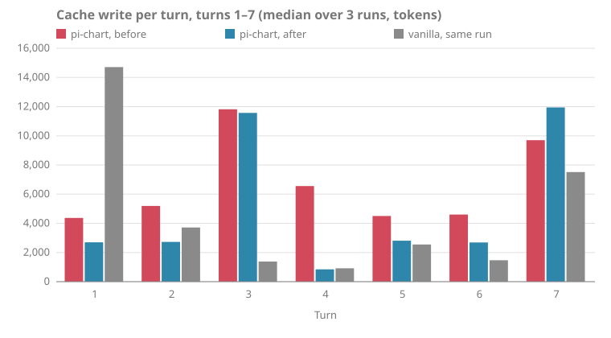

# Token usage after `pack-parts-follow-the-turn` — 2026-10-13

With the assembled parts after the Turn in progress (ADR-0010), early-turn cache writes fall to **1.09× vanilla**, from 2.13×. Prefix held rises to **65%**, from 18%, and stops there. The remaining misses are the API dropping pi-chart's thinking blocks as bound to a different prefix, which restarts the cache. No placement of a per-Call block can fix that, so the change was accepted at 65% (see [the change's evidence](../../openspec/changes/archive/2026-10-13-pack-parts-follow-the-turn/evidence/thinking-binding.md)).

- Commit: `bcb4a6d` plus this change's working tree
- Harness: omp 18.10.3, default model and thinking level
- Workload: the default 12 turns, `--runs 3`, both arms
- Raw figures: `2026-10-13-token-usage-parts-follow-turn.json`
- Before: `2026-10-13-token-usage.md`

## Gate

| Figure | Before (pi-chart) | After (pi-chart) | After (vanilla) | Gate | Result |
| --- | ---: | ---: | ---: | --- | --- |
| Prefix held, turns 1–7 | 18% | 65% | 100% | ≥ 90%, lowered to "rises from 18%" | pass (as revised) |
| Cache write, turns 1–7 | 46,588 | 34,854 | 31,932 | ≤ 1.25× vanilla | pass (1.09×) |

Each bar is the median over runs of one turn's summed cache writes. pi-chart's writes fall on five of seven turns. Turns 3 and 7 stay high for both pi-chart arms; why was not investigated. Vanilla's turn 1 is high because two of its three runs began with a cold cache (cache read 0 on their first Call). The table's totals are medians of per-Conversation sums, so they differ slightly from summing the bars.

## Per Conversation (median over runs)

| Metric | vanilla | pi-chart | pi-chart / vanilla |
| --- | ---: | ---: | ---: |
| Calls | 35 | 36 | 1.03× |
| Prompt tokens sent | 1,145,110 | 968,727 | 0.85× |
| Uncached input | 94 | 53,681 | 571× |
| Cache read | 1,087,542 | 793,372 | 0.73× |
| Cache write | 53,003 | 121,674 | 2.30× |
| Output | 9,691 | 13,859 | 1.43× |
| Effective input | 180,691 | 285,111 | 1.58× |
| Cost, USD | $0.8527 | $1.6177 | 1.90× |
| Peak window, tokens | 57,478 | 35,502 | 0.62× |

## Where the misses are

A rerun of turns 1–7 (`--runs 1`) went through a logging proxy, which recorded every request body and its usage. It reproduced the gap at 67%.

- At every miss, the next request carries the previous one's bytes unchanged up to the previous breakpoint, yet reads only what the previous Call read. The previous Call's whole write goes unread.
- Every miss follows a response that carried a thinking block. Vanilla held on all of its pairs after one.
- The stored copy of a finished Turn is byte-identical to the Journal's, so the Thread Store is not the cause.

**Cause.** On Claude Opus 5.5 a thinking block stays valid only while everything sent before it is unchanged. pi-chart's assembled block sits before the thinking produced on Call *n* and is replaced on Call *n+1*, which counts as an edit. The API then drops the block and restarts the cache there. A second proxied run with the `thinking-binding-controls-2026-08-01` header confirmed it from the API side: all 11 pi-chart Calls carrying thinking had every block dropped as `prefix_binding_mismatch` (53 drops), and no vanilla Call did. `--thinking off` doesn't avoid this: the model still returns signed, empty thinking blocks, and prefix held stayed at 64%. Full write-up: `openspec/changes/archive/2026-10-13-pack-parts-follow-the-turn/evidence/thinking-binding.md`. The fix is its own change, `keep-thinking-blocks-valid`.

## Limits

- One model. The binding check applies to Claude Opus 5.5, Sonnet 5.5, Haiku 5.5 and Fable 5.1; other models may show different prefix held.
- The codeword probe dropped to 1/3 for pi-chart; recall of turn 1 at turn 12 is outside this change.
- Turns 8–12 still include the tail slide, which `tail-evicts-to-low-water` covers.
- Dropped thinking blocks also cost quality, not only cache: the model loses its earlier reasoning on every Call. `evidence/quality.md` found no answer-level regression on 8 short Turns. Output ran 1.43× vanilla here, consistent with the model re-deriving reasoning it can no longer read ([INFERENCE]).
