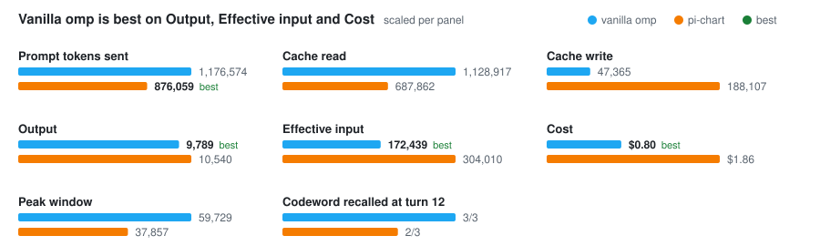
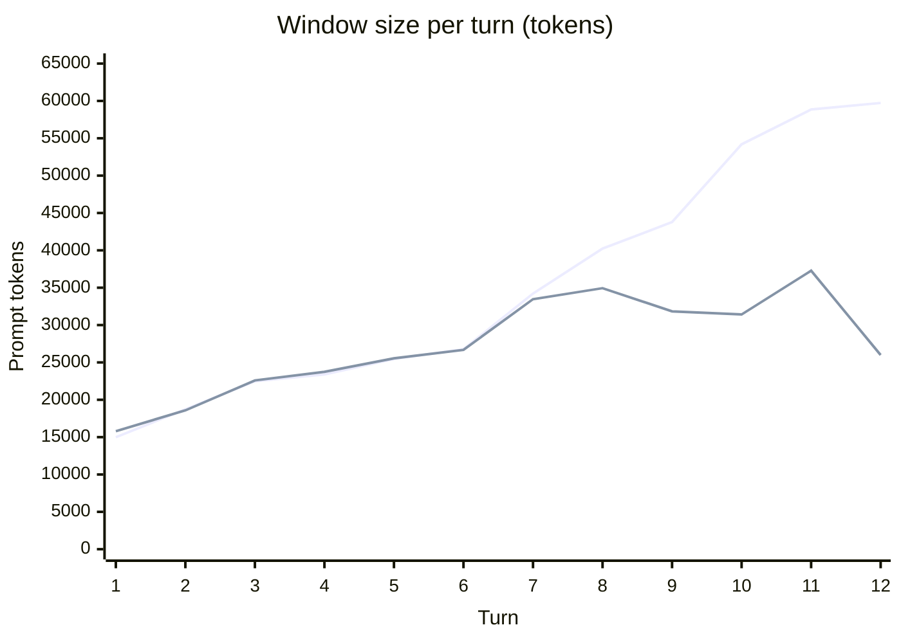

# Token usage: pi-chart vs plain omp — 2026-10-13

pi-chart sends **26% fewer prompt tokens** and keeps a **37% smaller peak window**, yet costs **2.3× as much** on this workload, because it writes the prompt cache **~4× as often**.

- Commit: `4dbe254` (Archive pin-user-context)
- Harness: omp v18.10.3, default model (`claude-opus-5-5`) and thinking level
- Workload: 12-turn Conversation, 3 runs per arm, 6 Conversations in parallel
- Instrument: `scripts/bench-tokens.ts`; raw figures in [`2026-10-13-token-usage.json`](2026-10-13-token-usage.json)
- Reproduce the tables: `bun scripts/bench-tokens.ts --report docs/benchmarks/2026-10-13-token-usage.json`

## Method

| Arm | Command |
| --- | --- |
| vanilla | `omp -p --no-title --no-extensions` |
| pi-chart | `omp -p --no-title --no-extensions -e src/extension.ts` |

Each run starts in a fresh copy of this Codebase at `HEAD`, one `omp` process per turn, `-c` from turn 2 on. Arms are interleaved so provider load hits both equally. Figures come from the provider-reported `usage` on every assistant message in the session Journal; subagent Journals are included (none occurred). Out of scope: the local embedder and the TypeSafe relevance judge, which never reach provider usage.

Workload (read-only questions about pi-chart's own source, so the window grows; the last prompt checks memory past the default tail of 8 turns):

1. Remember this codeword for later: TANGERINE-42. Then read src/pins.ts and say in two sentences what a Pin entry holds.
2. Read src/elision.ts. What does elision keep, and how is the shortened part marked? Three sentences at most.
3. Where is PICHART_TAIL_TURNS read, and what is its default? Answer in one sentence.
4. Read src/tokens.ts and explain how token counts are estimated.
5. Read src/sections.ts. What does it split, and on what boundaries?
6. Read src/shares.ts and summarise what it computes.
7. Read src/symbols.ts. How are symbols chosen for a pack?
8. Read src/report.ts. List the sections of the report it renders.
9. Read src/journal.ts. How is a Conversation's active branch found?
10. Read src/turns.ts and src/thread-store.ts. How does a Turn get into the Thread Store?
11. Read src/accounting.ts. What does a recorded part carry?
12. What codeword did I give you at the start of this conversation? Reply with just the codeword, or UNKNOWN if you do not know.

## Per Conversation (median over runs)

| Metric | vanilla | pi-chart | pi-chart / vanilla |
| --- | ---: | ---: | ---: |
| Calls | 35 | 33 | 0.94× |
| Prompt tokens sent (input + cache read + cache write) | 1,176,574 | 876,059 | 0.74× |
| Uncached input | 94 | 90 | 0.96× |
| Cache read | 1,128,917 | 687,862 | 0.61× |
| Cache write | 47,365 | 188,107 | 3.97× |
| Output | 9,789 | 10,540 | 1.08× |
| Effective input (read ×0.1, write ×1.25) | 172,439 | 304,010 | 1.76× |
| Cost, USD (harness pricing) | $0.8024 | $1.8621 | 2.32× |
| Peak window, tokens | 59,729 | 37,857 | 0.63× |
| Floor (system prompt + tools), tokens | 12,095 | 12,303 | 1.02× |
| Codeword recalled at turn 12 | 3/3 | 2/3 | — |

## At a glance

The table's figures, bars scaled per panel. `best` marks the lower figure on prompt tokens sent, output, effective input and cost.

## Window size per turn

Median prompt tokens of each turn's last Call. Mermaid `xychart-beta` draws no legend: in the per-turn charts the first series is vanilla, the second pi-chart.

| Turn | vanilla | pi-chart |
| ---: | ---: | ---: |
| 1 | 14,988 | 15,798 |
| 2 | 18,729 | 18,582 |
| 3 | 22,473 | 22,595 |
| 4 | 23,398 | 23,743 |
| 5 | 25,459 | 25,549 |
| 6 | 26,766 | 26,675 |
| 7 | 34,217 | 33,466 |
| 8 | 40,234 | 34,937 |
| 9 | 43,784 | 31,838 |
| 10 | 54,190 | 31,417 |
| 11 | 58,855 | 37,278 |
| 12 | 59,729 | 25,990 |

## Cache traffic per turn

Median over runs of each turn's summed cache writes and reads across all its Calls.

```mermaid
xychart-beta
    title "Cache write per turn (tokens)"
    x-axis "Turn" [1, 2, 3, 4, 5, 6, 7, 8, 9, 10, 11, 12]
    y-axis "Cache write tokens" 0 --> 50000
    bar "vanilla" [2626, 3741, 3744, 846, 2632, 1362, 7566, 5384, 3550, 10784, 4786, 767]
    bar "pi-chart" [4368, 5191, 11819, 6553, 4503, 4603, 9702, 38132, 19269, 18848, 46583, 13419]
```

```mermaid
xychart-beta
    title "Cache read per turn (tokens)"
    x-axis "Turn" [1, 2, 3, 4, 5, 6, 7, 8, 9, 10, 11, 12]
    y-axis "Cache read tokens" 0 --> 300000
    bar "vanilla" [40496, 47265, 60010, 45108, 69994, 51557, 85820, 106273, 123535, 284498, 165985, 58853]
    bar "pi-chart" [40619, 46799, 51723, 39969, 44705, 47855, 82861, 56397, 72073, 127947, 60644, 12567]
```

| Turn | write, vanilla | write, pi-chart | read, vanilla | read, pi-chart |
| ---: | ---: | ---: | ---: | ---: |
| 1 | 2,626 | 4,368 | 40,496 | 40,619 |
| 2 | 3,741 | 5,191 | 47,265 | 46,799 |
| 3 | 3,744 | 11,819 | 60,010 | 51,723 |
| 4 | 846 | 6,553 | 45,108 | 39,969 |
| 5 | 2,632 | 4,503 | 69,994 | 44,705 |
| 6 | 1,362 | 4,603 | 51,557 | 47,855 |
| 7 | 7,566 | 9,702 | 85,820 | 82,861 |
| 8 | 5,384 | 38,132 | 106,273 | 56,397 |
| 9 | 3,550 | 19,269 | 123,535 | 72,073 |
| 10 | 10,784 | 18,848 | 284,498 | 127,947 |
| 11 | 4,786 | 46,583 | 165,985 | 60,644 |
| 12 | 767 | 13,419 | 58,853 | 12,567 |

## Findings

- **The window win starts at turn 8.** That is where the tail reaches `PICHART_TAIL_TURNS=8` and stops growing. Through turn 7 the two windows are within ~3% of each other.
- **From turn 8 the cache stops paying.** pi-chart writes 38k and 47k tokens on turns 8 and 11 against vanilla's 5k. Its turn-12 cache read is exactly 12,567 in all three runs, which is only the system prompt and tools: everything after that was sent and written fresh. Dropping the oldest Turn from the tail changes the head of the assembled messages, and prompt caching reuses only an unchanged prefix (see ADR-0005, ADR-0006).
- **pi-chart already writes 1.6–3× more on turns 1–6,** before anything leaves the tail. `[INFERENCE]` per-Call recall and retrieval content changing between Calls; not verified.
- **Cost diverges more than effective input** (2.32× vs 1.76×): the harness prices the 1-hour cache writes the usage reports above the 1.25× multiplier used for effective input.
- **Memory check: one pi-chart run answered `UNKNOWN`** at turn 12. The codeword was outside the tail by then, so only recall could have supplied it.
- **The store was healthy:** omp logs show 17 `[pi-chart] Ingested 1 turn.` lines during the runs and no Thread Store unavailable warnings.

## Limits

- 3 runs per arm, one model, one workload. Longer Conversations favour pi-chart's bounded window; shorter ones favour vanilla's cache.
- Runs use the default session root, since pi-chart locates a Conversation's Journal only there; the bench Conversations were ingested into the Thread Store like any other.
