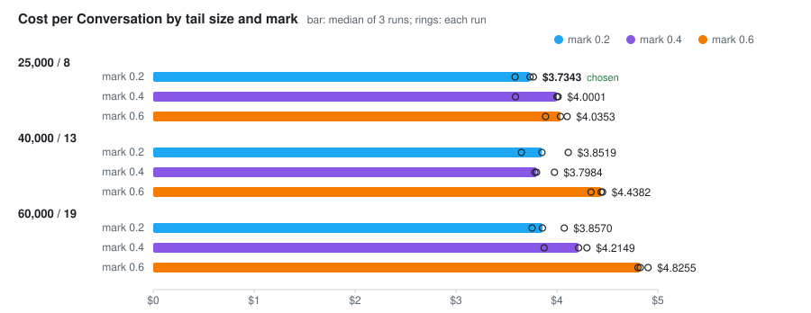

# Eviction defaults: tail size and low-water mark — 2026-10-14

Over the 40-Turn workload, a sweep of the tail's size (25,000 tokens / 8 Turns, 40,000 / 13, 60,000 / 19) against its low-water mark (0.2, 0.4, 0.6) picks **25,000 / 8 at mark 0.2**. That cell costs **$3.7343** per Conversation, against **$4.0353** at the old defaults (25,000 / 8 at 0.6), or 0.93×. The tail size stays. The default mark moves from 0.6 to 0.2. Every cell recalls the codeword 3/3, and every cell loses the build number 0/3.

## All cells

pi-chart arm alone, median per Conversation over 3 runs (`--report docs/benchmarks/2026-10-14-eviction-defaults-<tokens>-<mark>.json`). `read` calls are counted from each run's Journal.

| Tail (tokens / Turns) | Mark | Cost, USD | Uncached input | Cache read | Cache write | Output | Peak window | `read` calls | Codeword | Build number |
| --- | ---: | ---: | ---: | ---: | ---: | ---: | ---: | ---: | ---: | ---: |
| 25,000 / 8 | 0.2 | **$3.7343** | 338 | 3,127,869 | 286,631 | 40,858 | 37,296 | 71 | 3/3 | 0/3 |
| 25,000 / 8 | 0.4 | $4.0001 | 334 | 3,136,395 | 319,664 | 40,667 | 39,586 | 74 | 3/3 | 0/3 |
| 25,000 / 8 | 0.6 | $4.0353 | 338 | 3,271,350 | 314,104 | 41,698 | 40,388 | 70 | 3/3 | 0/3 |
| 40,000 / 13 | 0.2 | $3.8519 | 338 | 3,946,075 | 266,912 | 44,313 | 50,059 | 81 | 3/3 | 0/3 |
| 40,000 / 13 | 0.4 | $3.7984 | 344 | 3,973,507 | 269,692 | 42,667 | 50,163 | 70 | 3/3 | 0/3 |
| 40,000 / 13 | 0.6 | $4.4382 | 340 | 4,168,505 | 336,278 | 43,281 | 48,079 | 71 | 3/3 | 0/3 |
| 60,000 / 19 | 0.2 | $3.8570 | 346 | 4,873,574 | 251,319 | 44,152 | 62,293 | 79 | 3/3 | 0/3 |
| 60,000 / 19 | 0.4 | $4.2149 | 348 | 5,219,774 | 274,928 | 43,499 | 62,629 | 77 | 3/3 | 0/3 |
| 60,000 / 19 | 0.6 | $4.8255 | 354 | 5,659,720 | 353,450 | 45,255 | 64,795 | 74 | 3/3 | 0/3 |

At every tail size, 0.6 costs the most and has the most cache write. A high mark evicts fewer Turns at a time, so it evicts more often, and every Eviction rewrites the cache from the tail's start. A larger tail writes less to the cache, but it reads more on every Call: cache read goes from 3.13M to 4.87M at mark 0.2. On this workload the two effects roughly cancel.

## The rule, as applied

The rule was fixed in `openspec/changes/measured-eviction-defaults/design.md` (decision 4) before the sweep ran.

1. Eligible cells, codeword 3/3: all 9.
2. Lowest median cost: 25,000 / 8 at 0.2, $3.7343.
3. Tied, within $0.10 of it: 25,000 / 8 at 0.2 and 40,000 / 13 at 0.4 ($3.7984). Next out are 40,000 / 13 at 0.2 ($3.8519, +$0.118) and 60,000 / 19 at 0.2 ($3.8570, +$0.123).
4. Smallest tail first, then highest mark: **25,000 / 8 at 0.2**.

## Noise

The $0.10 tie band was set at twice the $0.05 gap between the two 0.6 runs of 2026-10-14. Within one cell, these runs spread far wider:

| Tail | Mark | Run costs, USD | Spread |
| --- | ---: | --- | ---: |
| 25,000 / 8 | 0.2 | 3.73, 3.77, 3.59 | $0.18 |
| 25,000 / 8 | 0.4 | 3.59, 4.01, 4.00 | $0.42 |
| 25,000 / 8 | 0.6 | 3.89, 4.10, 4.04 | $0.21 |
| 40,000 / 13 | 0.2 | 3.85, 4.11, 3.65 | $0.46 |
| 40,000 / 13 | 0.4 | 3.78, 3.80, 3.98 | $0.20 |
| 40,000 / 13 | 0.6 | 4.34, 4.45, 4.44 | $0.11 |
| 60,000 / 19 | 0.2 | 3.75, 4.07, 3.86 | $0.32 |
| 60,000 / 19 | 0.4 | 4.30, 3.87, 4.21 | $0.43 |
| 60,000 / 19 | 0.6 | 4.83, 4.80, 4.90 | $0.10 |

The order among the four cheapest cells is therefore within noise. The comparison that moves the default is not: at 25,000 / 8, each of the three 0.2 runs ($3.59–$3.77) costs less than each of the three 0.6 runs ($3.89–$4.10). Mark 0.4 at 25,000 / 8 cost $3.93 on 2026-10-14 and $4.00 here, from runs between $3.59 and $4.01. That fits the same spread. A future sweep that ranks cells this close needs more runs per cell.

## What a mark of 0.2 does

At 0.2 the count mark is ⌊8 × 0.2⌋ = 1 Turn, and the token mark is 5,000. Each Eviction therefore leaves the newest Turn alone in the tail, then the tail refills. Going by the drop in the window, the first Eviction came at turn 6, 6 and 10 in the three 0.2 runs, against turn 8, 8 and 6 at 0.6. Turn 3, the one carrying the build number, leaves the tail at the first Eviction under 0.2, which is about turn 6.

Dropping more at a time did not make the model re-read what it lost. `read` calls per Conversation are 71 at 0.2 and 70 at 0.6 at 25,000 / 8, and between 70 and 81 across all cells, with no trend by mark. Output is 40,858 at 0.2 against 41,698 at 0.6. The workload cannot measure quality beyond this: the codeword arrives through the Opening, and the build number leaves the tail in every cell.

## Turn size

The workload's Turns are about 3,000 tokens each [INFERENCE]. Over turns 1–7, the window grows from about 15,700 to about 32,000 tokens against a Floor of 12,641. On that basis the count Budget was scaled with the token Budget (8, 13, 19 Turns), so that the count would not be the Budget that triggers every Eviction. The size was not measured per Turn.

## Method

- Commit `4b08f27`. Each cell ran the pi-chart arm alone, 3 runs at `--parallel 3`, one cell at a time, with omp's default model and thinking level:
  `PICHART_TAIL_TOKENS=<t> PICHART_TAIL_TURNS=<n> PICHART_TAIL_LOW_WATER=<w> bun scripts/bench-tokens.ts --arm pi-chart --runs 3 --parallel 3 --out docs/benchmarks/2026-10-14-eviction-defaults-<t>-<w>.json`
- Workload: `DEFAULT_WORKLOAD` in `scripts/bench-tokens.ts`, 40 Turns of read-only work over pi-chart's own source. Turn 40 is the probe.
- All 27 runs completed, with no failed Turn. No run made a subagent Call.
- `read` calls are the `toolCall` blocks named `read` in each run's main Journal (`journal` in the JSON), with the median taken per cell.
- The first Eviction is the first turn whose last Call's prompt tokens fall by more than 3,000 from the turn before.

Raw figures: `2026-10-14-eviction-defaults-{25000,40000,60000}-{0.2,0.4,0.6}.json`.

## Window size per turn, chosen cell

25,000 / 8 at 0.2, median prompt tokens of each turn's last Call:

| Turn | pi-chart |
| ---: | ---: |
| 1 | 15,738 |
| 2 | 19,915 |
| 3 | 27,929 |
| 4 | 28,854 |
| 5 | 31,419 |
| 6 | 17,464 |
| 7 | 27,710 |
| 8 | 33,330 |
| 9 | 22,785 |
| 10 | 26,789 |
| 11 | 30,253 |
| 12 | 32,592 |
| 13 | 24,502 |
| 14 | 36,233 |
| 15 | 33,064 |
| 16 | 27,047 |
| 17 | 34,586 |
| 18 | 22,786 |
| 19 | 36,020 |
| 20 | 36,053 |
| 21 | 27,423 |
| 22 | 29,243 |
| 23 | 31,579 |
| 24 | 21,984 |
| 25 | 24,276 |
| 26 | 28,407 |
| 27 | 35,077 |
| 28 | 28,556 |
| 29 | 33,589 |
| 30 | 23,891 |
| 31 | 28,283 |
| 32 | 30,449 |
| 33 | 27,799 |
| 34 | 18,531 |
| 35 | 21,156 |
| 36 | 22,906 |
| 37 | 23,936 |
| 38 | 28,306 |
| 39 | 29,101 |
| 40 | 29,415 |
