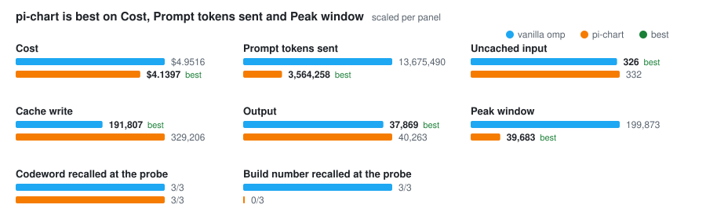

# Token usage over 40 Turns: Pins and the Opening ride the system prompt — 2026-10-14

On the 40-Turn workload pi-chart now costs **0.84× plain omp** ($4.1397 against $4.9516 per Conversation), down from **1.81×** ($10.3256) at `15f68bc`. Uncached input falls from **1,389,591 to 332 tokens** per Conversation, against plain omp's 326. Before this change, each Call's Briefing was rebuilt whenever the tail moved and was sent uncached. Now the Pins and the Opening sit in the system prompt, fixed for the Turn, and the messages are exactly the tail followed by the current Turn, so every Call reads its prefix from the cache (ADR-0015). The peak window is 39,683 tokens against 199,873 (0.20×).

## pi-chart against plain omp, after the change

Per Conversation, median over 3 runs per arm (`--report docs/benchmarks/2026-10-14-token-usage-40-turns-after.json`):

| Metric | vanilla | pi-chart | pi-chart / vanilla |
| --- | ---: | ---: | ---: |
| Calls | 123 | 126 | 1.02× |
| Prompt tokens sent (input + cache read + cache write) | 13,675,490 | 3,564,258 | 0.26× |
| Uncached input | 326 | 332 | 1.02× |
| Cache read | 13,483,357 | 3,251,623 | 0.24× |
| Cache write | 191,807 | 329,206 | 1.72× |
| Output | 37,869 | 40,263 | 1.06× |
| Effective input (read ×0.1, write ×1.25) | 1,588,420 | 731,489 | 0.46× |
| Cost, USD (harness pricing) | $4.9516 | $4.1397 | 0.84× |
| Peak window, tokens | 199,873 | 39,683 | 0.20× |
| Floor, tokens | 12,101 | 12,642 | 1.04× |
| Cache write, turns 1–7 | 31,323 | 28,470 | 0.91× |
| Prefix held, turns 1–7 (next Call read all the last read or wrote) | 100% | 100% | 1.00× |

Codeword recalled at the probe: vanilla 3/3, pi-chart 3/3.
Build number recalled at the probe: vanilla 3/3, pi-chart 0/3.

Cache write is 1.72× plain omp's: every Eviction moves the first message of the pack, and the Call after it writes the cache from there. Between Evictions the prefix holds (100% over turns 1–7).

The Floor is 541 tokens above plain omp's. It already excludes pi-chart's own system-prompt block, which the Accounting subtracts; what remains is the harness's catalog entries for pi-chart's tools.

## Before and after, pi-chart arm

`--report docs/benchmarks/2026-10-14-token-usage-40-turns-before.json` gives the before column; the after column is the table above.

| Metric (pi-chart arm) | before (`15f68bc`) | after | after / before |
| --- | ---: | ---: | ---: |
| Cost, USD (harness pricing) | $10.3256 | $4.1397 | 0.40× |
| Uncached input | 1,389,591 | 332 | ÷4,185 |
| Cache read | 2,843,599 | 3,251,623 | 1.14× |
| Cache write | 366,791 | 329,206 | 0.90× |
| Output | 62,151 | 40,263 | 0.65× |
| Effective input (read ×0.1, write ×1.25) | 2,090,182 | 731,489 | 0.35× |
| Peak window, tokens | 71,325 | 39,683 | 0.56× |
| Floor, tokens | 12,301 | 12,642 | 1.03× |
| Prefix held, turns 1–7 (next Call read all the last read or wrote) | 94% | 100% | 1.06× |

## The probe and the tools

The codeword comes back 3/3 through the Opening. The build number, given at turn 3, leaves the tail about ten turns later and comes back 0/3, before the change and after it.

The model called none of `recall_earlier_turns`, `search_documentation` or `codebase_structure` in any of the 3 after-runs or the 9 sweep runs: across the after-runs' pi-chart arm it made 209 `read`, 77 `grep` and 1 `bash` calls. There are no `recall_earlier_turns` result sizes to report.

This workload cannot show recall through the tool: the probe ends "Do not use any tools", so it measures what is in the window, not what the tools can bring back. The design's risk — recall now depends on the model choosing to search — is therefore unmeasured here. On a real omp session past the first Eviction (task 10.2), asked for an evicted codeword, the model called `recall_earlier_turns` and answered from the evicted Turn.

## Low-water mark

`PICHART_TAIL_LOW_WATER` over 0.4, 0.6 and 0.8, pi-chart arm alone, 3 runs each, median per Conversation:

| `PICHART_TAIL_LOW_WATER` | Cost, USD | Uncached input | Cache write | Codeword | Build number |
| ---: | ---: | ---: | ---: | ---: | ---: |
| 0.4 | $3.9293 | 340 | 309,280 | 3/3 | 0/3 |
| 0.6 | $4.0899 | 336 | 327,064 | 3/3 | 0/3 |
| 0.8 | $4.9219 | 348 | 420,457 | 3/3 | 0/3 |
| 0.6 (10.3 run) | $4.1397 | 332 | 329,206 | 3/3 | 0/3 |

0.4 is cheapest and 0.8 dearest: a high mark evicts less at a time and so more often, and each Eviction rewrites the cache (cache write 420,457 at 0.8 against 309,280 at 0.4). The two 0.6 rows, from separate runs, differ by $0.05, which bounds the noise. No value brings the build number back. Changing the default is a separate change.

## Method

- Workload: `DEFAULT_WORKLOAD` in `scripts/bench-tokens.ts`, 40 Turns of read-only work over pi-chart's own source; turn 40 is the probe. Model and thinking level: omp's defaults.
- Before: commit `15f68bc` in a separate worktree, with only the 40-Turn script copied in. After: the change's working tree.
- Sweep: `PICHART_TAIL_LOW_WATER=<w> bun scripts/bench-tokens.ts --arm pi-chart --runs 3 --parallel 3`; `--arm` writes raw figures only.
- Tool calls and the probe answers were read from each run's Journal (`journal` in the JSON).

Raw figures: `2026-10-14-token-usage-40-turns-before.json`, `2026-10-14-token-usage-40-turns-after.json`, `2026-10-14-token-usage-40-turns-low-water-{0.4,0.6,0.8}.json`.

## Window size per turn, after

Median prompt tokens of each turn's last Call:

| Turn | vanilla | pi-chart |
| ---: | ---: | ---: |
| 1 | 15,066 | 15,621 |
| 2 | 19,147 | 19,737 |
| 3 | 26,214 | 21,547 |
| 4 | 27,062 | 22,474 |
| 5 | 29,038 | 25,006 |
| 6 | 30,270 | 26,394 |
| 7 | 38,702 | 35,849 |
| 8 | 45,032 | 30,612 |
| 9 | 47,038 | 33,208 |
| 10 | 58,213 | 29,618 |
| 11 | 63,182 | 33,591 |
| 12 | 68,432 | 22,338 |
| 13 | 74,366 | 32,188 |
| 14 | 82,541 | 33,974 |
| 15 | 86,182 | 31,645 |
| 16 | 91,688 | 26,465 |
| 17 | 95,659 | 35,870 |
| 18 | 101,024 | 26,313 |
| 19 | 113,536 | 39,683 |
| 20 | 124,342 | 38,044 |
| 21 | 128,491 | 27,480 |
| 22 | 130,133 | 29,876 |
| 23 | 134,542 | 33,653 |
| 24 | 137,029 | 24,434 |
| 25 | 140,321 | 27,538 |
| 26 | 144,804 | 31,807 |
| 27 | 150,560 | 27,277 |
| 28 | 158,495 | 35,254 |
| 29 | 162,339 | 25,708 |
| 30 | 169,638 | 32,479 |
| 31 | 175,911 | 26,790 |
| 32 | 178,514 | 29,541 |
| 33 | 179,720 | 31,070 |
| 34 | 181,948 | 33,389 |
| 35 | 184,629 | 22,130 |
| 36 | 187,800 | 25,318 |
| 37 | 188,880 | 26,441 |
| 38 | 198,097 | 35,220 |
| 39 | 199,573 | 24,833 |
| 40 | 199,873 | 25,257 |
