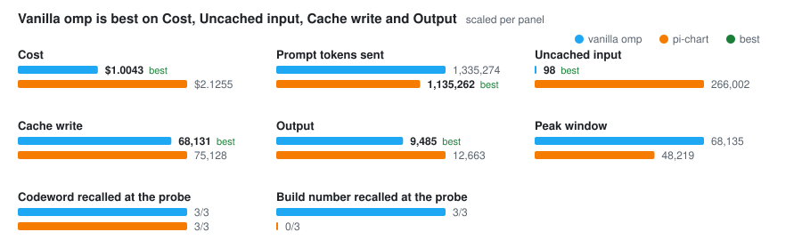
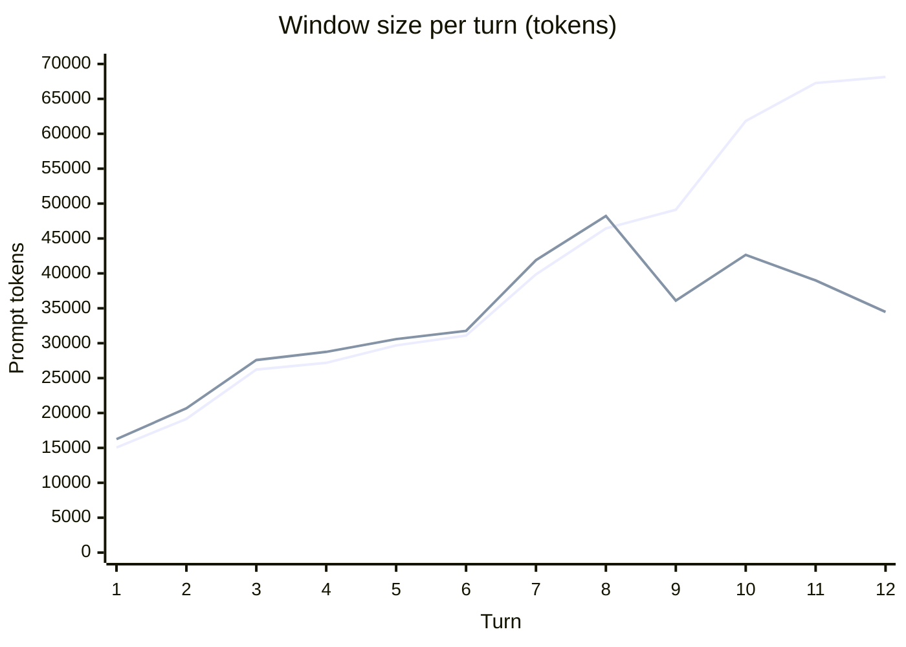

# Token usage: pi-chart vs plain omp — 2026-10-14

pi-chart sends **15% fewer prompt tokens**, keeps a **29% smaller peak window** and now writes the cache about as often as plain omp (**1.10×**). It still costs **2.12× as much**, and nearly all of the gap is **uncached input**: from the tail's first Eviction on, every Call pays 12–13k tokens of Briefing at the full input rate.

- Commit: `15f68bc` (Archive benchmark-doc-corrections), clean tree
- Harness: omp 18.10.4, default model (`claude-opus-5-5`) and thinking level
- Workload: the default 12-turn Conversation, 3 runs per arm, 6 Conversations in parallel
- Instrument: `scripts/bench-tokens.ts`; raw figures in [`2026-10-14-token-usage.json`](2026-10-14-token-usage.json)
- Reproduce the tables: `bun scripts/bench-tokens.ts --report docs/benchmarks/2026-10-14-token-usage.json`
- Previous run with this method: [2026-10-13](2026-10-13-token-usage.md)

## Method

The same as [2026-10-13](2026-10-13-token-usage.md#method): the vanilla arm is `omp -p --no-title --no-extensions`, the pi-chart arm adds `-e src/extension.ts`. Each run uses a fresh copy of the Codebase, with one `omp` process per turn and arms interleaved. Figures are the provider-reported `usage` on every assistant message. No subagent Calls occurred.

The workload differs from 2026-10-13 in two prompts, both changed by ADR-0014. Turn 3 now also gives a build number (`7341`). The turn-12 probe asks for the turn-1 codeword and that build number, and scores each separately. The codeword comes from the Opening. The build number can only come from recall. Turns 1–2 and 4–11 are unchanged.

pi-chart sent every Briefing as a kept, turn-scoped system message (ADR-0011): `briefing_mode` is `kept` on every assembled Call.

## Per Conversation (median over runs)

| Metric | vanilla | pi-chart | pi-chart / vanilla |
| --- | ---: | ---: | ---: |
| Calls | 37 | 35 | 0.95× |
| Prompt tokens sent (input + cache read + cache write) | 1,335,274 | 1,135,262 | 0.85× |
| Uncached input | 98 | 266,002 | 2714× |
| Cache read | 1,267,051 | 781,413 | 0.62× |
| Cache write | 68,131 | 75,128 | 1.10× |
| Output | 9,485 | 12,663 | 1.34× |
| Effective input (read ×0.1, write ×1.25) | 211,961 | 450,772 | 2.13× |
| Cost, USD (harness pricing) | $1.0043 | $2.1255 | 2.12× |
| Peak window, tokens | 68,135 | 48,219 | 0.71× |
| Floor, tokens | 12,087 | 12,294 | 1.02× |
| Cache write, turns 1–7 | 39,850 | 39,831 | 1.00× |
| Prefix held, turns 1–7 | 100% | 94% | 0.94× |
| Codeword recalled at the probe (turn 1, via the Opening) | 3/3 | 3/3 | — |
| Build number recalled at the probe (turn 3, via recall) | 3/3 | 0/3 | — |

## At a glance

The table's figures, bars scaled per panel. `best` marks the lower figure on cost, prompt tokens sent, uncached input, cache write and output.

## Where the cost goes

Harness rates, fitted exactly (largest residual 6×10⁻¹⁷ USD) from every Call's `usage` and `cost`: uncached input $4.00/M, cache read $0.20/M, cache write $8.00/M, output $20.00/M. Medians are taken per class, so the columns do not add up to the cost median.

| Token class | vanilla | pi-chart | pi-chart − vanilla |
| --- | ---: | ---: | ---: |
| Uncached input | $0.0004 | $1.0640 | +$1.0636 |
| Cache read | $0.2534 | $0.1563 | −$0.0971 |
| Cache write | $0.5450 | $0.6010 | +$0.0560 |
| Output | $0.1897 | $0.2533 | +$0.0636 |

The harness charges 0.05× input for a cache read and 2× for a cache write. The effective-input row above uses 0.1× and 1.25×, so it understates both what a write costs and how much a read saves.

## Window size per turn

Median prompt tokens of each turn's last Call. Mermaid `xychart-beta` draws no legend: the first series is vanilla, the second pi-chart.

| Turn | vanilla | pi-chart |
| ---: | ---: | ---: |
| 1 | 15,051 | 16,256 |
| 2 | 19,152 | 20,668 |
| 3 | 26,225 | 27,590 |
| 4 | 27,182 | 28,759 |
| 5 | 29,686 | 30,584 |
| 6 | 31,085 | 31,762 |
| 7 | 39,852 | 41,900 |
| 8 | 46,435 | 48,219 |
| 9 | 49,120 | 36,101 |
| 10 | 61,828 | 42,650 |
| 11 | 67,264 | 38,989 |
| 12 | 68,135 | 34,482 |

## Token traffic per turn

Median over runs of each turn's summed tokens across all its Calls.

```mermaid
xychart-beta
    title "Uncached input per turn (tokens)"
    x-axis "Turn" [1, 2, 3, 4, 5, 6, 7, 8, 9, 10, 11, 12]
    y-axis "Uncached input tokens" 0 --> 70000
    bar "vanilla" [8, 8, 8, 6, 8, 6, 8, 8, 8, 16, 8, 4]
    bar "pi-chart" [1061, 3431, 2512, 2641, 2354, 1903, 54228, 55488, 37558, 65076, 40307, 12377]
```

```mermaid
xychart-beta
    title "Cache write per turn (tokens)"
    x-axis "Turn" [1, 2, 3, 4, 5, 6, 7, 8, 9, 10, 11, 12]
    y-axis "Cache write tokens" 0 --> 18000
    bar "vanilla" [15049, 4115, 7073, 916, 2448, 1399, 8767, 6583, 3359, 12876, 4892, 773]
    bar "pi-chart" [7824, 4146, 7190, 876, 2114, 1319, 16050, 8150, 10769, 6792, 9821, 1074]
```

```mermaid
xychart-beta
    title "Cache read per turn (tokens)"
    x-axis "Turn" [1, 2, 3, 4, 5, 6, 7, 8, 9, 10, 11, 12]
    y-axis "Cache read tokens" 0 --> 400000
    bar "vanilla" [28122, 48481, 64534, 52644, 64849, 60022, 100297, 122884, 120290, 377824, 189111, 67262]
    bar "pi-chart" [35913, 49186, 65416, 53329, 56089, 59524, 77619, 114484, 54817, 128881, 56457, 22379]
```

| Turn | uncached, vanilla | uncached, pi-chart | write, vanilla | write, pi-chart | read, vanilla | read, pi-chart |
| ---: | ---: | ---: | ---: | ---: | ---: | ---: |
| 1 | 8 | 1,061 | 15,049 | 7,824 | 28,122 | 35,913 |
| 2 | 8 | 3,431 | 4,115 | 4,146 | 48,481 | 49,186 |
| 3 | 8 | 2,512 | 7,073 | 7,190 | 64,534 | 65,416 |
| 4 | 6 | 2,641 | 916 | 876 | 52,644 | 53,329 |
| 5 | 8 | 2,354 | 2,448 | 2,114 | 64,849 | 56,089 |
| 6 | 6 | 1,903 | 1,399 | 1,319 | 60,022 | 59,524 |
| 7 | 8 | 54,228 | 8,767 | 16,050 | 100,297 | 77,619 |
| 8 | 8 | 55,488 | 6,583 | 8,150 | 122,884 | 114,484 |
| 9 | 8 | 37,558 | 3,359 | 10,769 | 120,290 | 54,817 |
| 10 | 16 | 65,076 | 12,876 | 6,792 | 377,824 | 128,881 |
| 11 | 8 | 40,307 | 4,892 | 9,821 | 189,111 | 56,457 |
| 12 | 4 | 12,377 | 773 | 1,074 | 67,262 | 22,379 |

## Since 2026-10-13

pi-chart / vanilla on each run with this method. Medians over 3 runs per arm. Vanilla's own cost rose from $0.80 to $1.00 over the series, so compare the ratios rather than the dollar figures.

| Run | Commit | Cost | Uncached input (pi-chart) | Cache write | Peak window |
| --- | --- | ---: | ---: | ---: | ---: |
| [2026-10-13](2026-10-13-token-usage.md) | `4dbe254` | 2.32× | 90 | 3.97× | 0.63× |
| [parts follow the Turn](2026-10-13-token-usage-parts-follow-turn.md) | `bcb4a6d`+ | 1.90× | 53,681 | 2.30× | 0.62× |
| [Briefings kept](2026-10-13-token-usage-briefings-kept.md) | `aed7a71`+ | 1.55× | 44,297 | 1.98× | 0.58× |
| [the tail evicts](2026-10-13-token-usage-tail-evicts.md) | `e019c04`+ | 1.77× | 149,621 | 1.25× | 0.67× |
| this run | `15f68bc` | 2.12× | 266,002 | 1.10× | 0.71× |

## Findings

The per-Call figures below come from the run's Thread Store Accounting (`call_accounting` rows of the three pi-chart Conversations, found by their Codebases in the raw JSON).

- **The cache problem is solved; uncached input is the gap.** Over turns 1–7, cache write matches vanilla (1.00×) and the prefix held on 94% of Call pairs. Over the whole Conversation, cache write is 1.10× vanilla. Uncached input accounts for $1.06 of the $1.12 cost gap.
- **Uncached input starts at the first Eviction, turn 7.** Turns 1–6 send 13.5k–13.9k uncached tokens per run in total, and turns 7–12 send 217k–265k. Before the Eviction the tail carries every Turn, nothing is eligible for recall, and the Briefing is about 1k tokens per Call. After it, evicted Turns become eligible again: recall carries 3.2–3.3 Turns per Call on average, 7.0k–7.8k estimated tokens against its 8,000-token Budget, and every Call pays 12.0k–13.3k uncached on average. The current Briefing follows the cache breakpoint (ADR-0010), so on every Call it is billed at the full $4/M, 20× the price of a cache read. The measured uncached input exceeds the Briefing's estimated parts by about 4–5k per Call. This run does not separate estimator under-count from framing overhead [INFERENCE].
- **The token Budget evicts now, two Turns earlier than in the tail-evicts run.** Turns 1–6 come to 25.9k–26.7k tokens against `PICHART_TAIL_TOKENS=25000`, so at turn 7 the tail evicts down to turns 4–6 (7.1k–8.5k). It evicts again at turns 9 and 11 (turns 9 and 12 in run 2). In the tail-evicts run the count Budget evicted first, at turn 9. Two more Turns of Calls pay for recall, which is consistent with uncached input rising from 150k to 266k. Turn 3 alone is 10.0k–10.3k tokens here.
- **The Opening works; recall still misses turn 3.** The codeword came back 3/3 (2/3 on 2026-10-13). The build number came back 0/3. All three answered `UNKNOWN`. On the probe's first Call, recall excluded turn 3 as irrelevant at distances 0.537, 0.546 and 0.547, all above the 0.52 threshold. This is the same mechanism as the 2026-10-13 codeword miss. Recall carried turn 1 in every run, which is allowed to overlap with the Opening, and turns 5 and 7 in two runs.
- **The window win starts at turn 9.** pi-chart is 0.3k–2k above vanilla through turn 8, because the Briefing comes on top of the same tail. From turn 9 it stays at 34k–43k while vanilla grows to 68k.
- **Output is 1.34× vanilla, up from 1.13× after Briefings were kept.** Most of the excess is on turns 7–8: 1,942 and 1,880 against 1,259 and 1,238. This run does not measure why.
- **No Briefing narration.** None of the 36 pi-chart assistant text messages mentions the Briefing.

## Limits

- 3 runs per arm, one model, one workload. The workload changed at turn 3 and turn 12 since 2026-10-13 (see Method), so the series table compares ratios across a workload that moved.
- Uncached input is attributed to the Briefing from where omp places the cache breakpoint (ADR-0010) and from it tracking recall's size. No Call's uncached bytes were captured directly.
- Runs use the default session root, as before, so the bench Conversations were ingested into the Thread Store like any other.
