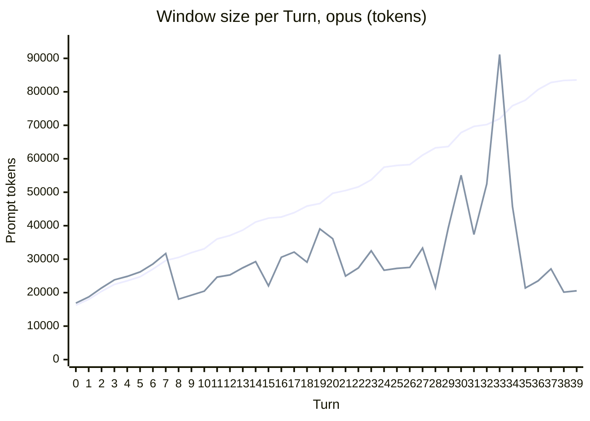
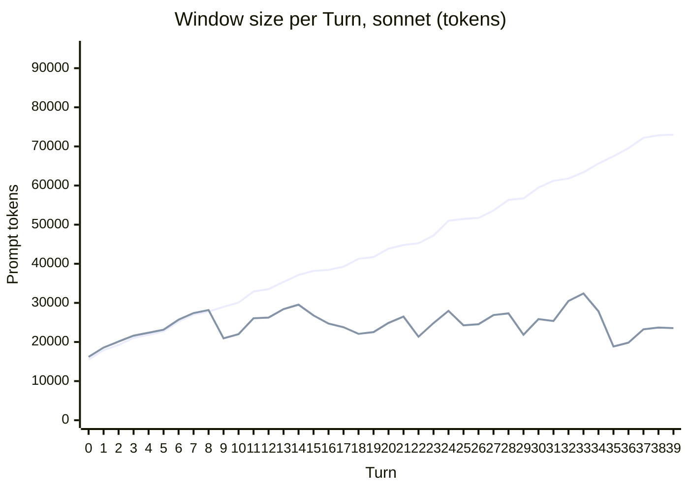

# Context need: pi-chart vs plain omp — 2026-10-19

On the Gate Workload, pi-chart costs **1.97× as much** as plain omp on opus and **1.32×** on sonnet, with **+25.7 and +20.5 Lapses per Run**. Every graded step still passes on both Arms. Almost all of the cost gap is now **cache write**, not uncached input. It splits about evenly between Evictions re-writing the prefix and Turns that grow 3.6× as much as plain omp's, as the agent re-reads files and recalls Turns the tail dropped. On the EvoCode subset, the halved window pays for the extra writes and cost is level (**1.06×**, 0.996× in the report).

- Commit: `65b9de1`
- Harness: omp/18.12.1, thinking high
- Batches: the Gate Workload (gate v1, 40 Turns) on `anthropic/claude-opus-5-5` and `anthropic/claude-sonnet-5-5`, 10 pairs each; the EvoCode subset (4 tasks, 7 complete pairs) on opus; Ablation on 4 opus Gate Runs
- Instrument: `scripts/compare.ts`. Its report is [`2026-10-19-plain-omp-comparison.md`](2026-10-19-plain-omp-comparison.md), with intervals and every Measure's definition. This document breaks those figures down.
- Derived figures: [`2026-10-19-context-need.json`](2026-10-19-context-need.json). They come from `measureRun` (`scripts/measures.ts`) on each Run folder, plus each pi-chart Run's `accounting.json` for Evictions. The Run folders are not committed.
- Previous cost run: 2026-10-14 (`docs/benchmarks/2026-10-14-token-usage.md` at `5c3275b`), on a different Workload

## Method

Each pair is one plain-omp Run and one pi-chart Run, started together, each in a fresh copy of the Workload. pi-chart ran at its defaults: a tail of 25,000 tokens / 8 Turns, low-water 0.2, and recall only through `recall_earlier_turns`. No Run had subagent Calls. Plain omp compacted 0 times.

The Gate Workload runs 40 Turns (numbered 0–39 here, as in the Run records) over six graded steps: buckets 0–6, turn-sizes 7–12, histogram 13–19, weights 20–26, render 27–33 and summary 34–38. Turn 39 is a recap Probe that forbids tools. Six Plants are scored at ten Probe points, and six Revisits send the agent back to a file it read earlier.

Tables give medians over a batch's 10 Runs per Arm, so the columns do not add up. The report's headline ratios are geometric means over pairs, so they differ slightly. Rates were fitted exactly (largest residual 5×10⁻¹⁶ USD) from every Call's `usage` and `cost`:

| Model | Uncached input | Cache read | Cache write | Output |
| --- | ---: | ---: | ---: | ---: |
| opus | $4.00/M | $0.20/M | $8.00/M | $20.00/M |
| sonnet | $2.00/M | $0.10/M | $4.00/M | $10.00/M |

An Eviction is a Turn whose first Call carried fewer tail Turns than the previous Turn carried, plus one. A Turn's growth is its last Call's prompt tokens minus its first Call's, plus its last output.

## Per Run, the Gate Workload

| Metric | opus: plain omp | opus: pi-chart | ratio | sonnet: plain omp | sonnet: pi-chart | ratio |
| --- | ---: | ---: | ---: | ---: | ---: | ---: |
| Calls | 124 | 146 | 1.18× | 96 | 122 | 1.27× |
| Prompt tokens sent | 5,877,838 | 4,347,360 | 0.74× | 4,026,507 | 2,932,691 | 0.73× |
| Uncached input | 327 | 372 | 1.14× | 272 | 324 | 1.19× |
| Cache read | 5,796,928 | 3,983,004 | 0.69× | 3,960,008 | 2,773,923 | 0.70× |
| Cache write | 70,753 | 386,368 | 5.46× | 60,058 | 154,641 | 2.57× |
| Output | 37,705 | 49,645 | 1.32× | 31,996 | 37,584 | 1.17× |
| Cost, USD | $2.48 | $4.89 | 1.97× | $0.96 | $1.27 | 1.32× |
| Peak window, tokens | 83,543 | 91,167 | 1.09× | 72,996 | 39,191 | 0.54× |
| Floor, tokens | 12,662 | 13,312 | 1.05× | 12,664 | 13,314 | 1.05× |
| Evictions | 0 | 12.8 (11–14) | — | 0 | 8.0 (6–9) | — |
| Graded steps passed | 60/60 | 60/60 | — | 60/60 | 60/60 | — |

Evictions are means, with the range. The first Eviction came at Turn 8 or 9 on opus and at Turn 9 on sonnet. Every Eviction, 128 on opus and 80 on sonnet, left one Turn in the tail.

## Where the cost goes

Medians per class:

| Token class | opus: plain omp | opus: pi-chart | opus: Δ | sonnet: plain omp | sonnet: pi-chart | sonnet: Δ |
| --- | ---: | ---: | ---: | ---: | ---: | ---: |
| Uncached input | $0.0013 | $0.0015 | +$0.0002 | $0.0005 | $0.0006 | +$0.0001 |
| Cache read | $1.1594 | $0.7966 | −$0.3628 | $0.3960 | $0.2774 | −$0.1186 |
| Cache write | $0.5660 | $3.0909 | +$2.5249 | $0.2402 | $0.6186 | +$0.3783 |
| Output | $0.7541 | $0.9929 | +$0.2388 | $0.3200 | $0.3758 | +$0.0559 |

Cache write by where the Call sits, in mean tokens per Run:

| Calls | opus: plain omp | opus: pi-chart | sonnet: plain omp | sonnet: pi-chart |
| --- | ---: | ---: | ---: | ---: |
| First Call of an Eviction Turn | 0 | 154,618 | 0 | 39,381 |
| First Call of any other Turn | 18,343 | 14,062 | 16,495 | 12,567 |
| Later Calls of a Turn | 55,312 | 221,024 | 45,719 | 102,817 |
| Total | 73,655 | 389,704 | 62,214 | 154,765 |

Turn growth per Run (median of the per-Run sums) is 65,511 against 236,071 tokens on opus (3.60×), and 54,961 against 111,444 on sonnet (2.03×). Here is what the agent did with its tools, in mean calls per Run:

| Tool | opus: plain omp | opus: pi-chart | sonnet: plain omp | sonnet: pi-chart |
| --- | ---: | ---: | ---: | ---: |
| read | 45.1 | 61.2 | 33.0 | 51.6 |
| grep | 1.7 | 6.4 | 0.2 | 8.6 |
| recall_earlier_turns | — | 9.3 | — | 2.5 |
| search_documentation | — | 0.0 | — | 0.6 |

Each `recall_earlier_turns` result held about 8.5k estimated tokens on opus (79,257 per Run) and 6.1k on sonnet (15,305 per Run).

## Window size per Turn

The median prompt tokens of each Turn's last Call, on opus. Mermaid `xychart-beta` draws no legend: the first series is plain omp, the second pi-chart.

The same on sonnet: pi-chart stays between 18.8k and 32.4k after its first Eviction, and plain omp grows to 73.0k.

## Turn growth

The median growth of each Turn on opus. The render step (Turns 27–33) is where pi-chart's Turns grow most.

```mermaid
xychart-beta
    title "Growth within each Turn, opus (tokens)"
    x-axis "Turn" [0, 1, 2, 3, 4, 5, 6, 7, 8, 9, 10, 11, 12, 13, 14, 15, 16, 17, 18, 19, 20, 21, 22, 23, 24, 25, 26, 27, 28, 29, 30, 31, 32, 33, 34, 35, 36, 37, 38, 39]
    y-axis "Tokens" 0 --> 45000
    bar "plain omp" [2403, 1712, 2565, 2040, 827, 1231, 2074, 2593, 380, 1525, 1031, 2817, 351, 1816, 2035, 1085, 7, 1325, 1980, 281, 3358, 494, 677, 2211, 3665, 9, 280, 3283, 1980, 9, 4833, 1927, 4, 2079, 3656, 1717, 2692, 2043, 260, 46]
    bar "pi-chart" [2441, 1694, 2359, 2109, 821, 1306, 2228, 2662, 382, 1810, 964, 4100, 247, 2838, 2909, 1227, 7473, 1906, 2901, 10657, 4281, 1089, 2732, 6873, 4589, 9, 390, 5211, 1815, 18124, 21996, 3175, 34567, 41465, 5741, 1228, 2490, 3531, 2467, 112]
```

## Lapses and Retention

The Gate's Lapses per Run (means) are Re-fetches of a result that had left the window, plus recall Pulls, plus failed Probes. Plain omp has none of any kind.

| Lapse | opus: pi-chart | sonnet: pi-chart |
| --- | ---: | ---: |
| Re-fetch after the result left | 11.2 | 11.1 |
| Recall Pull | 9.3 | 2.6 |
| Failed Probe | 5.2 | 6.8 |
| Total | 25.7 | 20.5 |

6.0 of opus's 9.3 recall Pulls, and 1.1 of sonnet's 2.6, reach back 1–5 Turns. Revisits are not in the Gate total. In 44 of 60 opus Revisits and 45 of 60 sonnet Revisits, the file was fetched again after the earlier read had left the window. Plain omp had none on either model.

Retention per Plant and Probe point. Plain omp was right at every point on both models (10/10).

| Plant @ Probe Turn | Kind | Distance | opus: pi-chart | Source of a right opus answer | sonnet: pi-chart |
| --- | --- | ---: | ---: | --- | ---: |
| codename @ 25 | superseded | 2 | 10/10 | tail 7, recall 3 | 8/10 |
| owner-line @ 31 | constraint | 3 | 1/10 | recall 1 | 4/10 |
| test-tag @ 20 | constraint | 10 | 7/10 | tail 5, recall 1, unknown 1 | 0/10 |
| reviewer @ 16 | literal | 11 | 10/10 | recall 7, tail 3 | 4/10 |
| codename @ 39, no tools | superseded | 16 | 0/10 | — | 0/10 |
| row-limit @ 32 | superseded | 26 | 10/10 | recall 9, tail 1 | 10/10 |
| ticket @ 29 | literal | 27 | 10/10 | recall 10 | 3/10 |
| row-limit @ 39, no tools | superseded | 33 | 0/10 | — | 0/10 |
| reviewer @ 39, no tools | literal | 34 | 0/10 | — | 0/10 |
| ticket @ 39, no tools | literal | 37 | 0/10 | — | 0/10 |

A "tail" source on an evicted Plant means a later tool result brought the value back into the tail, for example a re-read of the notes file.

## EvoCode subset

Medians over the 7 complete pairs on opus, pooled across the 4 tasks. The report weighs each task equally and gives 0.996× [0.673×, 1.475×].

| Metric | plain omp | pi-chart | pi-chart / plain omp |
| --- | ---: | ---: | ---: |
| Calls | 87 | 106 | 1.22× |
| Prompt tokens sent | 9,680,641 | 4,911,880 | 0.51× |
| Cache read | 9,493,430 | 4,608,680 | 0.49× |
| Cache write | 171,392 | 302,972 | 1.77× |
| Output | 97,357 | 118,526 | 1.22× |
| Cost, USD | $5.17 | $5.49 | 1.06× |
| Peak window, tokens | 182,724 | 83,573 | 0.46× |

These tasks run 7–9 Turns of many Calls each, so the window's size comes from within a Turn. Mean per Run, cache read saved $0.98 and cache write cost $1.04 more. pi-chart made 0.29 recall Pulls and had 0.57 Lapses per Run. Graded rounds differ only on `security_patch_hardening`, which has one complete plain-omp Run against two pi-chart Runs: round 2 passed 1/1 against 1/2, and round 8 0/1 against 2/2. The subset has no Plants, so Retention is not measured on it.

## Ablation and Utilisation

These figures cover 4 opus Gate Runs (pairs 0 and 1), 20 units each, at a total cost of $30.96.

| Arm | Needed share [95%] | Unstable Calls | Utilisation |
| --- | ---: | ---: | ---: |
| plain omp | 1/37, 2.7% [0.5%, 13.8%] | 6/44 | 14.1% |
| pi-chart | 4/40, 10.0% [4.0%, 23.1%] | 11/51 | 29.0% |

Utilisation is uncalibrated. The only calibration set, for gate v1 on opus, was frozen under omp/18.11.0 at κ 0.17, below the 0.4 floor, and these Runs used omp/18.12.1. Used is not Needed.

## Since 2026-10-14

The 2026-10-14 run (`docs/benchmarks/2026-10-14-token-usage.md` at `5c3275b`) used a 12-Turn Conversation, so its figures are not comparable with these. What has changed is where the gap sits:

| Run | Workload | Cost | Uncached input (pi-chart) | Cache write | Peak window |
| --- | --- | ---: | ---: | ---: | ---: |
| 2026-10-14 | 12 Turns, opus | 2.12× | 266,002 | 1.10× | 0.71× |
| this run | gate v1, 40 Turns, opus | 1.97× | 372 | 5.46× | 1.09× |
| this run | gate v1, 40 Turns, sonnet | 1.32× | 324 | 2.57× | 0.54× |

On 2026-10-14, recall rode in the Briefing after the cache breakpoint, and every Call paid for it at the full input rate. Recall is now the `recall_earlier_turns` tool (`PICHART_RECALL_TURNS` is retired), so uncached input fell to plain omp's level. The recalled content now enters as tool results inside a Turn, where it is cache-written.

## Findings

- **The cost gap is cache write.** On opus, cache write adds $2.52 per Run (median), cache read saves $0.36 and output adds $0.24. On sonnet the same three figures are +$0.38, −$0.12 and +$0.06. Uncached input differs by less than a cent.
- **Evictions and Turn growth split it about evenly.** On opus, the first Call of an Eviction Turn writes 154.6k tokens per Run, about $1.24. The later Calls of each Turn write 165.7k more than plain omp's, about $1.33. On sonnet, the same two figures are 39.4k ($0.16) and 57.1k ($0.23). Each Eviction re-writes the prefix: the median first-Call write is 6.6k on an Eviction Turn and 0.4k on any other.
- **Low-water 0.2 leaves one Turn, and the agent goes back for the rest.** All 208 Evictions left a single Turn. Most recall Pulls reach only 1–5 Turns back (6.0 of 9.3 on opus), and each one brings in about 8.5k tokens. Reads rise from 45.1 to 61.2 and greps from 1.7 to 6.4. In 44 of 60 Revisits, the file was fetched again after the earlier read had left the window.
- **On opus this feeds back into the window.** In the render step, pi-chart's Turns 29, 30, 32 and 33 grow by 18k–41k each, against at most 4.8k on plain omp. Opus peaks at Turn 33 in 8 of 10 Runs, and its median peak window (91.2k) sits above plain omp's (83.5k). Sonnet Pulls a quarter as often, never reaches that peak, and keeps a 0.54× peak window.
- **A Probe that forbids tools always lapses.** The Turn 39 recap scores 0/40 on both models. pi-chart's window then holds the Opening and one tail Turn, and a Pull is its only way back. With tools allowed, opus recalled Plants from 26–27 Turns back 20/20, and sonnet 13/20.
- **Constraint Plants lapse at short distance.** `owner-line` was 1/10 on opus at distance 3, and `test-tag` was 0/10 on sonnet at distance 10. [INFERENCE] The agent does not Pull for a value it does not know applies. The Workload cannot tell this apart from a recall miss.
- **Pulling more trades cost for Retention.** Opus Pulls 9.3 times per Run, has 5.2 failed Probes and costs 1.97×. Sonnet Pulls 2.6 times, has 6.8 failed Probes and costs 1.32×.
- **Lapses did not cost a graded step.** Both Arms passed 60/60 steps on both models. On this Workload, a Lapse costs money and Retention, not correctness.
- **EvoCode is level on cost.** On long Turns with many Calls, the smaller window (peak 0.46×) halves cache read, which offsets 1.77× cache write. Lapses were rare (0.57 per Run).
- **pi-chart's tail is denser in what the next action needs**, but not significantly: a 10.0% Needed share against 2.7%, with overlapping intervals.

## Limits

- 10 pairs per model on one Workload, which was written knowing how pi-chart works. The EvoCode check has 4 tasks and df 3. Ablation covers 4 Runs.
- Plain omp never compacted, so this compares pi-chart's Eviction against a window that never fills, not against omp's compaction.
- Every Run is isolated. `recall_across_conversations`, `search_documentation`, `walk_documentation` and `codebase_structure` had nothing of the Run's own to return, and were Pulled at most 0.6 times per Run.
- The cache-write split by Call position is a proxy. It attributes all of an Eviction Turn's first-Call write to the Eviction, including that Turn's new prompt.
- Turn growth uses provider prompt tokens. The Assembler's own estimates run below them (one opus Turn 33 Call: 57.2k estimated against 93.0k sent), so tail sizes in `accounting.json` are not comparable with these figures.
- Utilisation is uncalibrated for these Runs (see Ablation and Utilisation).
